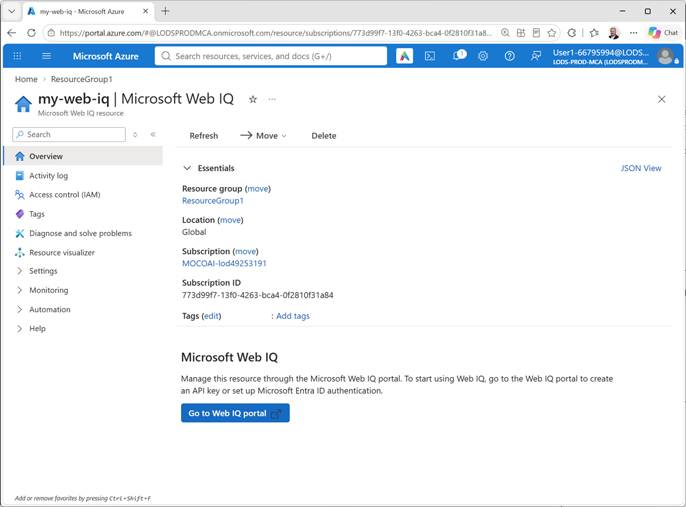
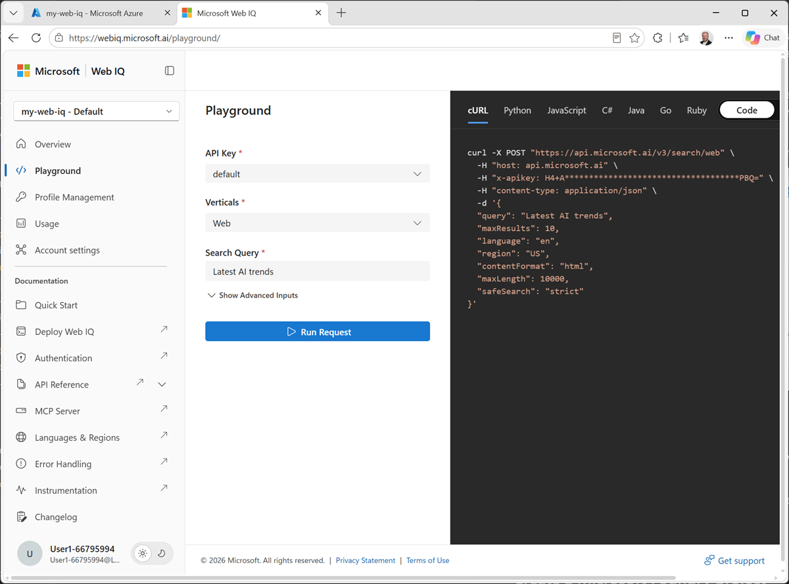
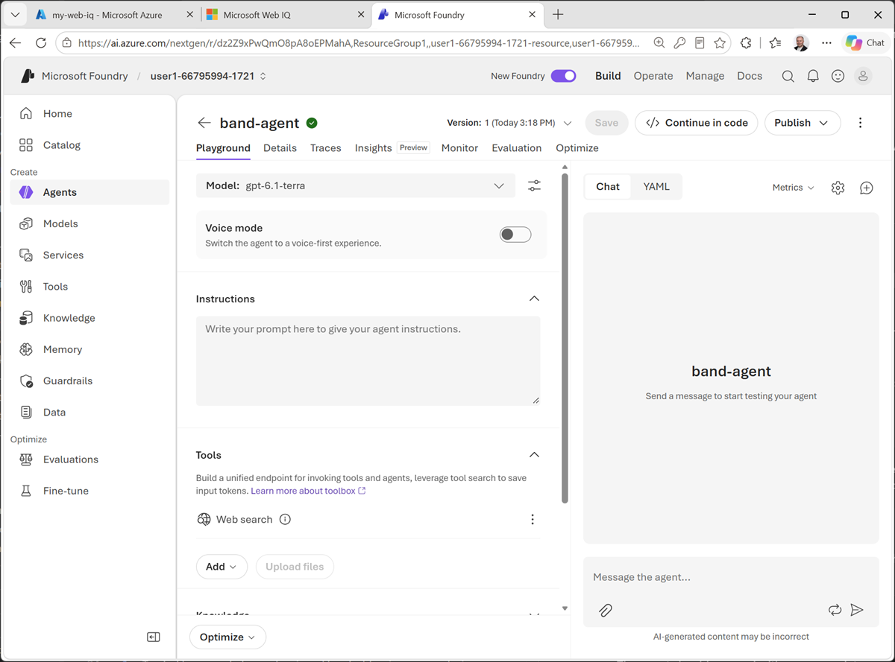
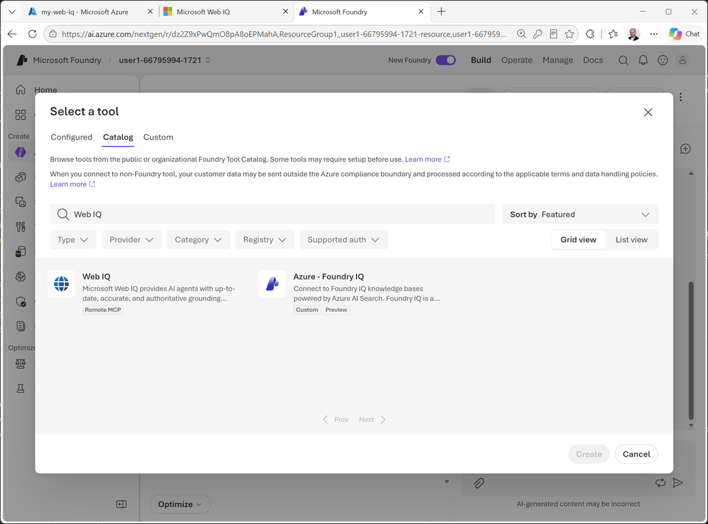
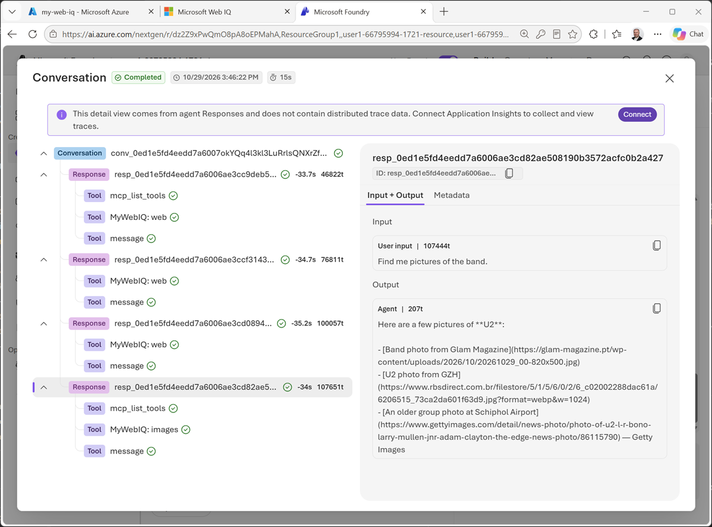

---
lab:
  title: Integrate web search into an agent using Web IQ
  description: Use Web IQ to integrate web search capabilities into an agent in Microsoft Foundry.
  level: 200
  duration: 30 minutes
  islab: true
---

# Integrate web search into an agent using Web IQ

In this exercise, you'll use Microsoft Web IQ to integrate web search results into an AI agent's context; enabling the agent to access up to date information that was not included in its training data.

> **Important**: Microsoft Web IQ requires a *paid* Azure subscription, such as an account in an organization's tenant or a pay-as-you-go personal subscription. Free trial subscriptions or a ones that are pre-funded with Azure credits (such as MSDN benefit subscriptions) are <u>not</u> supported.

This exercise should take approximately **30** minutes to complete.

## Create a Web IQ resource in Azure

Microsoft Web IQ is an Azure service that retrieves information from the web and returns search results that are optimized for AI agents.

1. In a web browser open the [Azure portal](https://portal.azure.com){:target="_blank"} at `https://portal.azure.com` and sign into your Azure subscription.
1. Add a new **Microsoft Web IQ** resource in a new or existing resource group, specifying a name of your choice, selecting the **Global** region, and accepting the terms of use.
1. When the Web IQ resource has been created, open it.

    

## Explore the Web IQ portal

Now that you have a Web IQ resource, you can test it in the Web IQ portal.

1. In the page for your Web IQ resource, select **Go to Web IQ portal** and navigate to the Web IQ portal.

    When prompted, select you Azure subscription and the Web IQ resource you just created.

1. Open your Web IQ resource in the playground.

    

1. Review the parameters for a Web IQ query, which include:
    - An *API key* (used to authenticate the request).
    - A *vertical* that determines the type of results returned (Web, Videos, News, or Images).
    - A *search query* used to find results on the web.

1. Run the default request and review the results returned in the pane on the right (you can view the returned JSON or preview the formatted results).
1. View the **Profile management** page, and note that the default API key is listed here. You can copy it to the clipboard for use in a connection to the resource from a Foundry project.

## Create a Microsoft Foundry project

Microsoft Foundry uses *projects* to organize models, resources, data, and other assets used to develop an AI solution.

> **Note**: Many components of Microsoft Foundry, including the Microsoft Foundry portal, are subject to continual development. This reflects the fast-moving nature of artificial intelligence technology. Some elements of your user experience may differ from the images and descriptions in this exercise!

1. In a new web browser tab (leaving the Web IQ portal open), open [Microsoft Foundry](https://ai.azure.com){:target="_blank"} at `https://ai.azure.com` and sign in using your Azure credentials. Close any tips or quick start panes that are opened the first time you sign in, and if necessary use the **Foundry** logo at the top left to navigate to the home page.
1. If it isn't already enabled, in the tool bar the top of the page, enable the **New Foundry** option.
1. If you do not have any existing projects, one may be created for you. If not, create a new project with a unique name; expanding the  **Advanced options** area to specify the following settings for your project (or you can select an existing project if you have one!):
    - **Foundry resource**: *A valid name for your Foundry resource.*
    - **Subscription**: *Your Azure subscription*
    - **Resource group**: *Create or select a resource group*
    - **Region**: Select any of the **AI Foundry recommended** regions in [this list](https://learn.microsoft.com/azure/foundry/openai/how-to/responses#supported-regions){:target="_blank"}

    > **Tip**: Depending on your permissions in the Azure subscription, you may need to clear the option to set up recommended resources.

1. Wait for your project to be created. It may take a few minutes. Then close any welcome dialogs that are displayed.

## Create an AI agent

Now you're ready to create an agent.

1. In the Foundry portal, create a new agent named `band-agent`. If prompted, set the **Interaction mode** to **Text**.

     When ready, your agent opens in the agent playground.

    

1. In the model drop-down list, ensure that a model has been deployed and selected for your agent.
1. Assign your agent the following **Instructions**:

    ```
   You are an AI agent that answers questions about bands and music artists.
    ```

1. In the **Tools** area, if the **Web search** tool is listed, use its **&vellip;** menu to **Remove** it.

    > **Note**: The default Web search tool uses Microsoft Bing to retrieve web results for grounding. While this tool provides useful results, the Web IQ resource we're going to add later is more optimized for agentic information retrieval.

1. Use the **Save** button to save the changes.
1. Test the agent by entering the following prompt in the **Chat** pane:

    ```
   What can you tell me about The Rolling Stones?
    ```

    *(Or use any current musical artist or band you like!)*

    The agent should respond with an appropriate answer based on its instructions.

1. Now try this:

    ```
   Are they playing any gigs soon?
    ```

    The agent may respond with what *seems* like a correct answer. However, the agent currently has no up-to-date knowledge after its training cut-off date.

    Let's fix that!

## Add a Web IQ tool

In Foundry, you can add a Web IQ tool to your agent, enabling it to use your Web IQ resource to search the web.

1. In the **Tools** section, in the **Add** dropdown list, select **Add tools**.
1. In the **Select a tool** dialog box, on the **Catalog** tab, search for `Web IQ`.

    

1. Create a **Web IQ** tool, giving it a suitable name and pasting the API key for your Web IQ resource (which you can copy from the **Profile management** page in the Web IQ portal).
1. In the agent playground, confirm that the **Web IQ** tool is listed in the **Tools** section, and use its **&vellip;** menu to configure it with an approval setting to **Always auto-approve all tools**.

    *This configuration ensures that you can test all of the tools provided by the Web IQ resource over its MCP interface without needing to explicitly approve each request.*

1. Save the changes to your agent.

    > **Note**: This will restart the chat session.

## Use the agent with Web IQ

Now that you have added the Web IQ tool to your agent, it can choose to use it when necessary to respond to prompts.

1. Enter the same initial prompt as before:

    ```
   What can you tell me about The Rolling Stones?
    ```

    You may get a similar response to the previous attemot; but it might include additional information obtained from the web.

1. Try a prompt that requires up-to-date information:

    ```
   Are they playing any gigs soon?
    ```

    If the band have any upcoming concerts, the results might reflect them (if not, try a follow up prompt like `What about U2?` or some other artist you know to be touring.)

1. Try searching for a images:

    ```
    Find me pictures of the band.
    ```

    The results should include links to any images that were found.

1. Under the results in the chat pane, select **Traces** to see a record of the messages and tool calls in the conversation. The trace should include calls made to your Web IQ tool.

    

## Summary

In this exercise, you created a Web IQ resource in your Azure subscription and added a connection to it from a Web IQ tool in a Microsoft Foundry project. You were then able to use Web IQ to ground prompts for an agent, which could use the search results to return relevant responses.

## Clean Up

If you have finished exploring Microsoft Foundry, you should delete the resources created in this exercise to avoid unnecessary utilization charges.

Open the [Azure portal](https://portal.azure.com){:target="_blank"} at `https://portal.azure.com` and delete the resources you used in this exercise.
