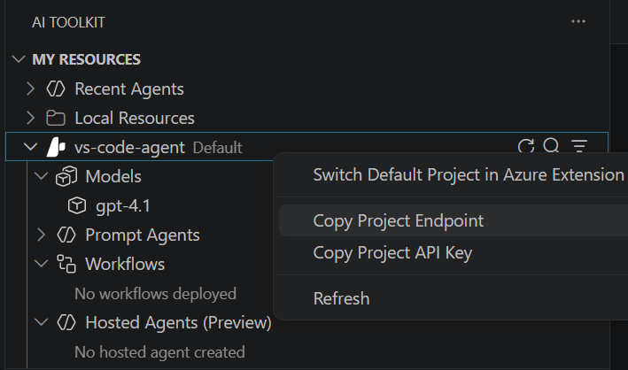

---
lab:
    title: 'Connect to remote agents with A2A protocol'
    description: 'Use the A2A protocol to collaborate with remote agents.'
    level: 300
    duration: 30
    islab: true
    status: 'released'
---

# Connect to remote agents with A2A protocol

In this exercise, you'll use Microsoft Foundry with the Agent Framework and the A2A protocol to create simple remote agents that interact with one another. These agents will assist technical writers with preparing their developer blog posts. A title agent will generate a headline, and an outline agent will use the title to develop a concise outline for the article. A routing agent will discover both agents and delegate work to them over A2A. Let's get started.

> **Tip**: The code used in this exercise is based on the Agent Framework and A2A SDKs for Python. You can develop similar solutions using the SDKs for Microsoft .NET, JavaScript, and Java. Refer to [Microsoft Foundry SDK client libraries](https://learn.microsoft.com/azure/ai-foundry/how-to/develop/sdk-overview) for details.

This exercise should take approximately **30** minutes to complete.

> **Note**: Some of the technologies used in this exercise are in preview or in active development. You may experience some unexpected behavior, warnings, or errors.

## Prerequisites

Before starting this exercise, ensure you have:

- [Visual Studio Code](https://code.visualstudio.com/) installed on your local machine
- An active [Azure subscription](https://azure.microsoft.com/free/)
- [Python 3.13](https://www.python.org/downloads/) installed
- [Git](https://git-scm.com/downloads) installed on your local machine
- The [Azure CLI](https://learn.microsoft.com/cli/azure/install-azure-cli) installed (used to sign in with `az login`)

> \* Python 3.14 isn't supported yet: some dependencies have no 3.14 build. This lab was tested with Python 3.13.12.

## Create a Foundry project with the Foundry Toolkit for VS Code extension

As a developer, you may spend some time working in the Foundry portal; but you’re also likely to spend a lot of time in Visual Studio Code. The Foundry Toolkit for VS Code extension provides a convenient way to work with Foundry project resources without leaving the development environment.

1. Open Visual Studio Code.

2. Select **Extensions** from the left pane (or press **Ctrl+Shift+X**).

3. Search the extensions marketplace for the `Foundry Toolkit` extension from Microsoft and select **Install**.

    > **Note**: The extension is currently listed as **Foundry Toolkit**, but some VS Code labels, commands, or older screenshots may still refer to **AI Toolkit**. In this lab, treat those names as referring to the same extension experience.

4. After installing the extension, select its icon in the sidebar to open the Foundry Toolkit view.

    You should be prompted to sign in to your Azure account if you haven't already.

5. Select **Create Project** under **Microsoft Foundry Resources**.

    If a default project is already active, the project name will appear under **My Resources**. You can create a new project by right-clicking on the active project and selecting **Switch Default Project in Azure Extension**.

6. Select your Azure subscription and resource group, then enter a name for your Foundry project to create a new project for this exercise.

    When the deployment is complete, you should see the project appear in the Foundry Toolkit pane as the default project.

## Deploy a model

At the core of any generative AI project, there’s at least one generative AI model. In this task, you'll deploy a model from the Model Catalog to use with your agent.

1. When the "Project deployed successfully" popup appears, select the **Deploy a new model** button. This opens the Model Catalog.

   > **Tip**: You can also access the Model Catalog by selecting the **+** icon next to **Models** in the Resources section, or by pressing **F1** and running the command **Foundry Toolkit: Show model catalog**.

1. In the Model Catalog, locate the **gpt-5.4** model (you can use the search bar to find it quickly).

1. Select **Deploy** next to the gpt-5.4 model.

1. Configure the deployment settings:
   - **Deployment name**: Enter a name like "gpt-5.4"
   - **Deployment type**: Select **Global Standard** (or **Standard** if Global Standard is not available)
   - **Model version**: Leave as default
   - **Tokens per minute**: Leave as default

1. Select **Deploy to Microsoft Foundry** in the bottom-left corner.

1. Wait for the deployment to complete. Your deployed model will appear under the **Models** section in the Resources view.

1. Right-click the name of the project deployment and select **Copy Project Endpoint**. You'll need this URL to connect your agent to the Foundry project in the next steps.

    

## Clone the starter code repository

For this exercise, you'll use starter code that already hosts Foundry agents and a routing client. You'll add the key pieces that turn those agents into A2A agents. You'll clone this code from a GitHub repository.

1. In VS Code, open the Command Palette (**Ctrl+Shift+P** or **View > Command Palette**).

1. Type **Git: Clone** and select it from the list.

1. Enter the repository URL:

    ```
   https://github.com/MicrosoftLearning/mslearn-ai-agents.git
    ```

1. Choose a location on your local machine to clone the repository.

1. When prompted, select **Open** to open the cloned repository in VS Code.

1. Once the repository opens, select **File > Open Folder** and navigate to `mslearn-ai-agents/Labfiles/09-build-remote-agents-with-a2a`, then choose **Select Folder**.

1. In the Explorer view, navigate to the **Labfiles/09-build-remote-agents-with-a2a/python** folder to find the starter code for this exercise.

    The provided files include:

    ```output
   python
   ├── agent_definitions.py
   ├── agent_executor.py
   ├── a2a_server.py
   ├── routing_client.py
   ├── run_all.py
   ├── requirements.txt
   └── .env
    ```

    - **agent_definitions.py** defines the Foundry-backed **title** and **outline** agents, and the A2A **agent card** for each one.
    - **agent_executor.py** receives incoming A2A messages and runs the agent.
    - **a2a_server.py** hosts an agent as an A2A server. You start it with `--agent-type title` or `--agent-type outline`.
    - **routing_client.py** contains the **routing agent**, which discovers the title and outline agents and sends them work, and a chat loop that lets you submit prompts to it.
    - **run_all.py** starts both agent servers and then runs the routing client.

1. Right-click on the **requirements.txt** file and select **Open in Integrated Terminal**.

1. In the terminal, enter the following command to install the required Python packages in a virtual environment:

    ```
   python -m venv labenv
   .\labenv\Scripts\Activate.ps1
   pip install -r requirements.txt
    ```

    > **Tip**: If `pip install` fails with a 404 or metadata error for one of the packages, upgrade `pip` with `python -m pip install --upgrade pip` and run the install command again.

1. Open the **.env** file, replace the **your-account** and **your-project** placeholders in `FOUNDRY_PROJECT_ENDPOINT` with the endpoint for your project (copied from the project deployment resource in the Foundry Toolkit extension) and ensure that the `FOUNDRY_MODEL` variable is set to your model deployment name. Use **Ctrl+S** to save the file after making these changes.

## Create a discoverable agent

In this task, you create the title agent that helps writers create trendy headlines for their articles. You also define the agent's skill and card, which the A2A protocol uses to make the agent discoverable.

> **Tip**: As you add code, be sure to maintain the correct indentation. Use the existing comments as a guide, entering the new code at the same level of indentation.

1. Open the **agent_definitions.py** file in the code editor.

    The file already contains the instructions for both agents (`TITLE_INSTRUCTIONS` and `OUTLINE_INSTRUCTIONS`) and a complete outline agent. Use the outline agent code as a reference for the title agent.

1. In the `create_title_agent` function, find the comment **Create the title agent** and add the following code to create the agent:

    ```python
   # Create the title agent
   return Agent(client=client, name="TitleAgent", instructions=TITLE_INSTRUCTIONS)
    ```

    The `client` is a `FoundryChatClient` connected to the model deployment in your Foundry project. The `Agent` class combines the model with the agent's instructions.

1. In the `get_title_agent_card` function, find the comment **Define the agent skill** and add the following code to describe what the agent can do:

    ```python
   # Define the agent skill
   skill = AgentSkill(
       id="generate_blog_title",
       name="Generate Blog Title",
       description="Generates a blog title based on a topic.",
       tags=["title", "agent-framework"],
       examples=["Give me a title for a post about remote agents."],
   )
    ```

1. Find the comment **Create the agent card** and add the following code to define the metadata that makes the agent discoverable:

    ```python
   # Create the agent card
   return AgentCard(
       name="TitleAgent",
       description="Generates a catchy blog post title for a given topic.",
       version="1.0.0",
       default_input_modes=["text"],
       default_output_modes=["text"],
       capabilities=_CAPABILITIES,
       supported_interfaces=[AgentInterface(url=url, protocol_binding="JSONRPC", protocol_version="1.0")],
       skills=[skill],
   )
    ```

    The agent card is like a business card for the agent. It tells other agents the agent's name, what it does, and the URL and protocol to use to contact it. Other agents read the description to decide when to use this agent.

1. Save the code file (*CTRL+S*).

## Host the agent as an A2A server

In this task, you expose the title agent over HTTP so that other agents can discover it and send it messages.

1. Open the **a2a_server.py** file in the code editor.

    The `main` function creates the Foundry client, creates the agent and its card for the type you choose, and creates a **request handler** that connects the A2A protocol to the agent. The `Starlette` web app then needs routes for the A2A endpoints.

1. In the `routes` list, find the comment **Serve the agent card** and add the following code:

    ```python
   # Serve the agent card so other agents can discover this one
   *create_agent_card_routes(agent_card),
    ```

    This publishes the agent card at `/.well-known/agent-card.json`, the standard location where A2A clients look for it.

1. Find the comment **Accept A2A messages** and add the following code:

    ```python
   # Accept A2A messages (JSON-RPC) and pass them to the request handler
   *create_jsonrpc_routes(request_handler, "/"),
    ```

    This adds the endpoint that receives A2A messages from other agents and hands them to the request handler.

1. Save the code file (*CTRL+S*).

## Enable messages to reach the agent

The server can now receive A2A messages, but something needs to run the agent when one arrives. That's the job of the agent executor. In this task, you complete the executor that the request handler calls.

1. Open the **agent_executor.py** file in the code editor.

    The `AgentExecutor` class must implement the methods `execute` and `cancel`. The `cancel` method and the code that streams the agent's reply back as A2A **artifacts** are already provided. The `TaskUpdater` object reports the task's progress to the caller.

1. In the `execute` method, find the comment **Convert the A2A message into arguments for the Agent Framework agent** and add the following code:

    ```python
   # Convert the A2A message into arguments for the Agent Framework agent
   run = a2a_to_run(context.message, stream=True)
    ```

1. Find the comment **Run the agent and stream each update** and add the following code:

    ```python
   # Run the agent and stream each update back to the caller as an A2A artifact
   stream = agent.run(run["messages"], session=session, options=run["options"], stream=True)
    ```

    The code that follows turns each update from the agent into an A2A artifact and sends it back to the caller.

1. Find the comment **Mark the task as complete** and add the following code:

    ```python
   # Mark the task as complete
   await updater.complete()
    ```

1. Save the code file (*CTRL+S*).

    The title agent is now a complete A2A agent. The outline agent uses the same server and executor code, with its own instructions and card, so you don't need to write it again.

## Discover and call remote agents

In this task, you complete the routing agent. It discovers the title and outline agents from their agent cards and uses them as tools.

1. Open the **routing_client.py** file in the code editor.

    The routing agent is a Foundry-backed agent whose **tools** are the remote agents. When you send it a prompt, it decides which remote agent to call, sends that agent an A2A message, and uses the reply to answer you. For a request that needs a title and an outline, it calls the title agent first and passes the title to the outline agent.

    The `main` function loops over the URL of each remote agent.

1. Find the comment **Discover the remote agent by fetching its agent card** and add the following code:

    ```python
   # Discover the remote agent by fetching its agent card
   card = await A2ACardResolver(httpx_client=http_client, base_url=url).get_agent_card()
    ```

1. Find the comment **Connect to the remote agent over A2A** and add the following code:

    ```python
   # Connect to the remote agent over A2A
   remote = await stack.enter_async_context(
       A2AAgent(name=card.name, description=card.description, agent_card=card, url=url)
   )
    ```

    `A2AAgent` is a client for the remote agent. From the routing agent's point of view, it behaves like any other agent.

1. Find the comment **Give the routing agent the remote agent as a tool it can call** and add the following code:

    ```python
   # Give the routing agent the remote agent as a tool it can call
   tools.append(remote.as_tool())
    ```

    The `as_tool` method wraps the remote agent as a function tool. Its name and description come from the agent card, which is how the routing agent knows what each remote agent does.

1. Save the code file (*CTRL+S*).

## Test the application

1. In the integrated terminal, enter the following commands to run the application:

    ```
   az login
    ```

    ```
   python run_all.py
    ```

    The application uses the credentials for your authenticated Azure session to connect to your project. `run_all.py` starts the title agent and the outline agent as A2A servers, waits for each one to become healthy, and then starts the routing client. You should see the routing agent discover both agents.

1. Wait until the prompt for input appears, then enter a prompt such as:

    ```
   Create a title and outline for an article about React programming.
    ```

    After a few moments, you should see a response with a title from the title agent and an outline from the outline agent. The routing agent sent each request to those agents over A2A. You can experiment with different prompts to see how the routing agent uses the remote agents.

1. Enter `quit` to exit the program and stop the servers.

    You can also use `deactivate` to exit the Python virtual environment in the terminal.

### Optional: Explore the agent card

To see what the routing agent saw during discovery, start a server on its own and request its agent card:

```
python a2a_server.py --agent-type title
```

Then, in a second terminal, enter:

```
curl http://localhost:10007/.well-known/agent-card.json
```

The JSON that's returned is the agent card you defined. Press **Ctrl+C** in the first terminal to stop the server.

## Clean up

If you've finished exploring Microsoft Foundry, you should delete the resources you have created in this exercise to avoid incurring unnecessary Azure costs.

1. Return to the browser tab containing the Azure portal (or re-open the [Azure portal](https://portal.azure.com) at `https://portal.azure.com` in a new browser tab) and view the contents of the resource group where you deployed the resources used in this exercise.
1. On the toolbar, select **Delete resource group**.
1. Enter the resource group name and confirm that you want to delete it.
